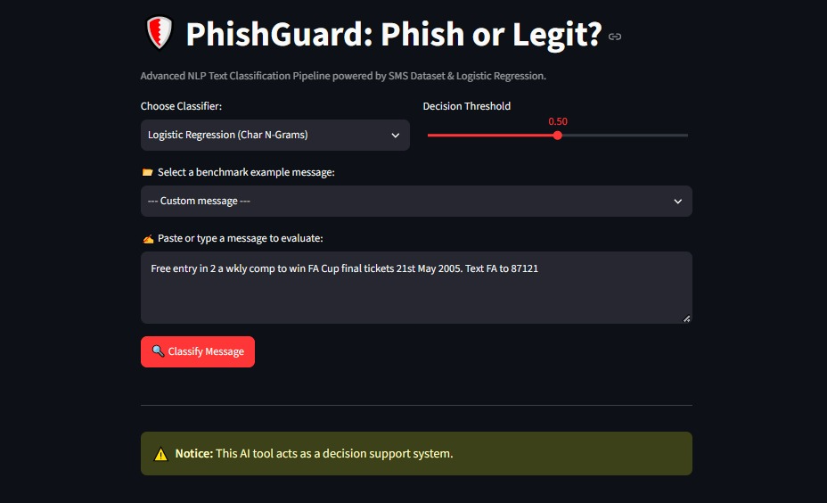
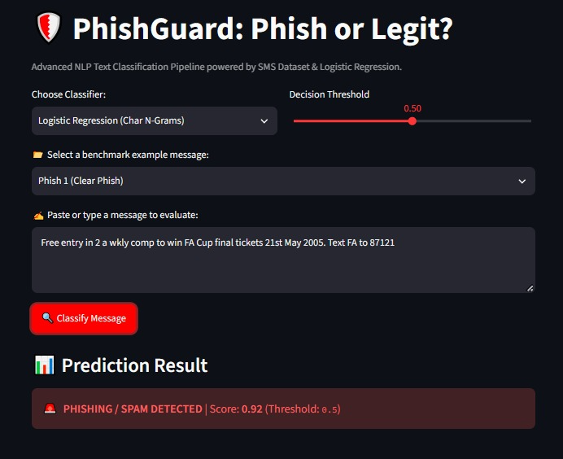
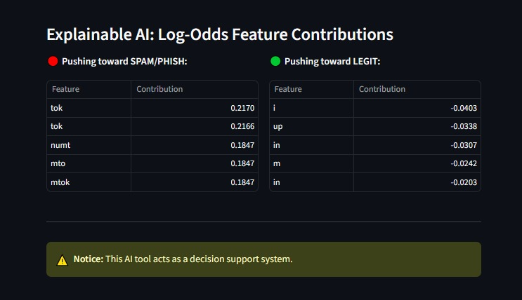
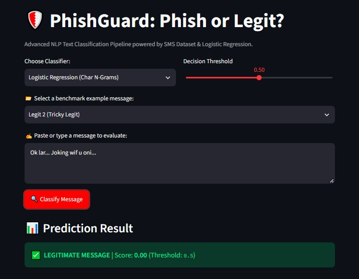
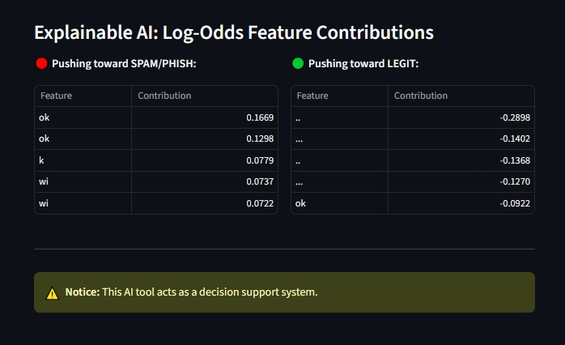
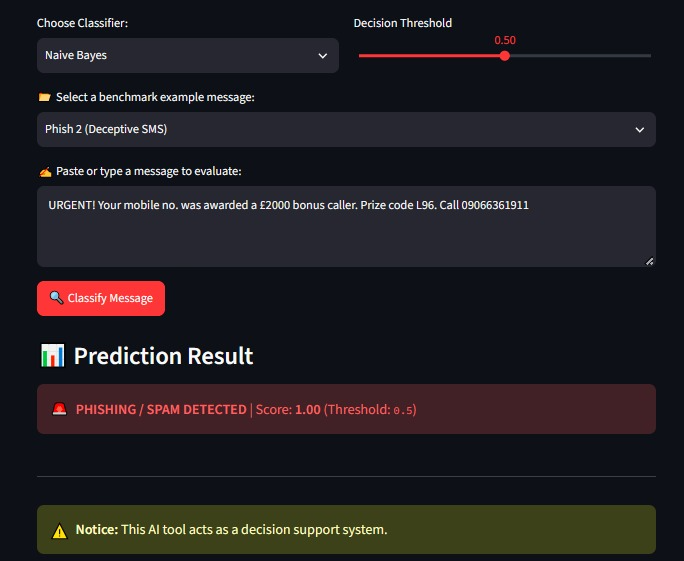
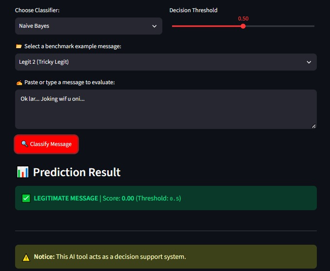

# 🛡️ PhishGuard: Phish or Legit? (NLP Text Classification)
An advanced Natural Language Processing (NLP) web application built with **Streamlit**, **Scikit-Learn**, and **Python**, designed to detect phishing and spam SMS messages using machine learning pipelines, multi-model evaluation, and **Explainable AI (XAI)** capabilities.

🔗 **Live Demo:** [Try PhishGuard on Streamlit Cloud](https://phishguard-ml-majrisalma.streamlit.app)

---

##  Dataset & Model Evaluation Performance

- **Dataset:** Integrated and synchronized directly from the official remote **UCI SMS Spam Collection dataset (`sms.tsv`)** hosted on GitHub to ensure robust generalization and clean label mapping (`spam` → 1, `ham` → 0).
- **Models Implemented:**
  - **Logistic Regression** (with Word and Char N-Grams extensions).
  - **Naive Bayes** (MultinomialNB with word features and optional calibration).

- **Evaluation Results:** Running `python -m src.evaluate` outputs the following rigorous performance metrics across test splits:

| Model | Accuracy | F1 | Precision | Recall |
|-------|----------|----|-----------|--------|
| **Naive Bayes** | 99.1% | 0.964 | 0.994 | 0.936 |
| **Logistic Regression** | 98.8% | 0.953 | 0.978 | 0.930 |
| **NB + Calibration** | 98.9% | 0.956 | 	0.010 | 0.007 |
| **LR + Char N-Grams** | 99.0% | 0.962 | 	0.012 | 0.024 |

---

##  Application Walkthrough & Screenshots

### 1. Main Interface & Benchmark Selection (Logistic Regression)


*The main Streamlit interface of PhishGuard showing the Logistic Regression classifier, decision threshold slider, and benchmark example dropdown.*

### 2. Phishing Detection Result (High Confidence)


*Evaluation of a clear phishing SMS ("Phish 1"). The model successfully detects and flags the message as **PHISHING / SPAM DETECTED** with a high confidence probability score of **0.92**.*

### 3. Explainable AI: Log-Odds Feature Contributions (Phishing)


*Detailed feature-level breakdown for the Logistic Regression model showing log-odds contributions pushing the decision toward spam/phishing (red table).*

### 4. Legitimate Message Detection (Zero Score)


*Testing a legitimate message ("Legit 2"). The model correctly evaluates and outputs a **LEGITIMATE MESSAGE** classification with a score of **0.00**.*

### 5. Explainable AI: Log-Odds Feature Contributions (Legit)


*Log-odds feature contributions for the legitimate message displaying negative weights pushing the decision toward the legitimate class (green table).*

### 6. Naive Bayes Classifier Evaluation (Phish 2)


*Testing a deceptive SMS ("Phish 2") using the **Naive Bayes** classifier, yielding a high phishing confidence score of **1.00**.*

### 7. Naive Bayes Classifier Evaluation (Legit 2)


*Testing the legitimate message ("Legit 2") using the **Naive Bayes** classifier, resulting in a clean score of **0.00**.*


---
##  Installation & Running Locally

1. **Clone the repository:**
   ```bash
   git clone https://github.com/Salma-Majri/PhishGuard-ML.git
   cd PhishGuard-ML
   ```

2. **Create and activate a virtual environment:**
   ```bash
   python -m venv .venv
   .venv\Scripts\activate   # On Windows
   # source .venv/bin/activate   # On macOS/Linux
   ```

3. **Install dependencies:**
   ```bash
   pip install -r requirements.txt
   ```

4. **Run the evaluation script:**
   ```bash
   python -m src.evaluate
   ```

5. **Launch the Streamlit App:**
   ```bash
   streamlit run app.py
   ```